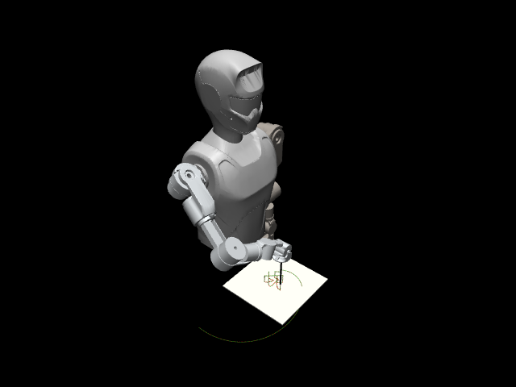
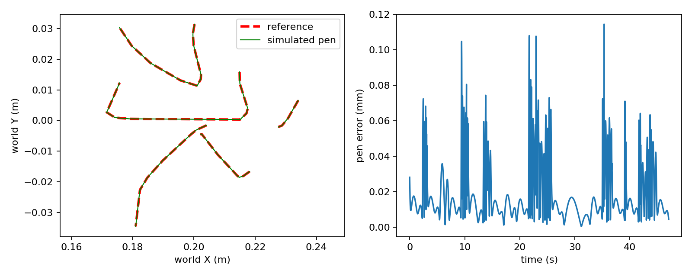
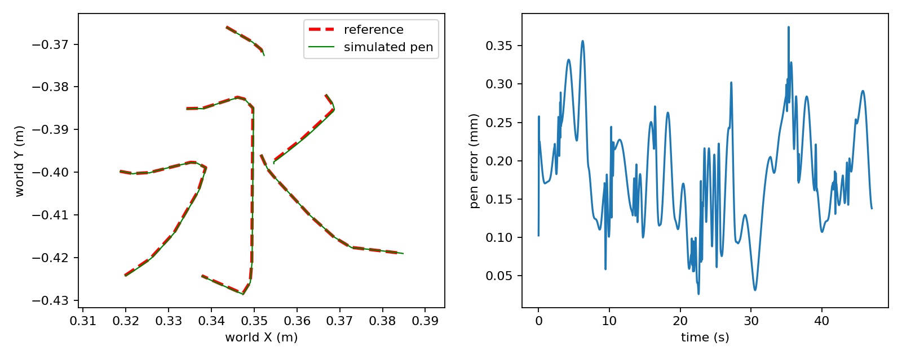
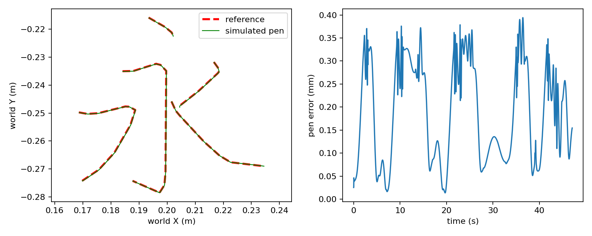

# 面向低成本与异构机械臂的双线性 Koopman–MPC：抗扰、Sim2Real 与可复用汉字书写

## 摘要

模型预测控制（MPC）结合数据驱动的 Koopman 提升，可为非线性机械臂提供近似凸的在线优化框架，但在低成本、存在间隙的硬件上，观测噪声与未建模负载对闭环质量的影响，以及不同机械臂之间书写程序难以复用的问题，仍缺乏系统实证。本文在 SO-ARM101（5 自由度、百美元量级）上完成四类 Koopman 网络（DKUC、DBKN、IKN、IBKN）的统一训练与闭环消融，并将无迹卡尔曼滤波（UKF）与 Koopman 空间扩张状态观测器（KESO）置于同一提升坐标中，分别抑制噪声与慢变负载扰动。进一步地，本文将笔画生成、时间参数化、逆运动学、五秒连续进场、基线/MPC 跟踪与结果归档组织为可复用仿真流程，并通过 YAML 配置适配 Piper（6 轴）、WheelArmR/X02/G1 等七轴右臂及多台整机模型，实现多笔画抬落笔、字形旋转与工具姿态解耦。

仿真闭环表明：开环验证损失接近的架构，在噪声条件下闭环误差可相差数十倍，双线性项对控制质量更为关键；KESO 相对“仅 UKF、有负载”条件可将位置跟踪范数由约 0.263 降至约 0.015（约 17.5 倍），相对完全无补偿的噪声+负载条件约降低两个数量级。归档的七组“永”字无接触仿真中，Piper、WheelArmR、X02 的 DBKN–MPC 笔尖位置 RMSE 分别为 0.1673、0.1939、0.2182 mm。新增多臂试验均在理想重力补偿、无接触条件下完成，不能外推为真机书写精度或跨机器人权重泛化。本文贡献定位为系统组合、架构消融、可复现软件流程与工程边界说明，而非新的 Koopman 理论结果。

**关键词：** Koopman 算子；模型预测控制；扰动抑制；扩张状态观测器；无迹卡尔曼滤波；Sim2Real；汉字书写；异构机械臂

---

## 一、引言

低成本可 3D 打印机械臂（如 SO-ARM100/101）显著降低了操作研究门槛，但其执行器精度有限、存在间隙且缺乏出厂标定，使得依赖精确一阶原理模型的控制更困难。Koopman 算子理论提供了一条数据驱动路径：学习将状态映射到更高维空间的提升函数，使动力学在输入上近似线性或双线性，从而将有限时域最优控制转化为可实时求解的二次规划问题。深度学习已用于参数化该提升；双线性扩展可刻画状态–控制耦合，这是纯线性-in-control 模型所缺失的。

面向廉价硬件，仍有两类问题论证不足：（1）闭环控制质量在多大程度上取决于具体 Koopman 架构，而非仅取决于开环预测精度；（2）如何在不引入完整非线性原状态观测器的前提下，抑制观测噪声与未建模负载，使 MPC 在间隙与标定误差并存时仍可用。

与此同时，汉字书写需要多笔画抬笔–转移–落笔、工具姿态与字形朝向解耦，以及在不同自由度与工作区几何下的连续逆解。若每台机器人单独复制一套轨迹与控制代码，软件成本会随平台数量快速上升。本文在 SO-ARM101 抗扰与虚实迁移工作基础上，补充多机械臂书写适配与统一配置入口，使同一套规划–训练–跟踪流程可在 5–7 轴臂及若干整机模型上复用。

本文的应用型贡献概括如下：

1. **架构消融：** 在相同数据采集与损失配方下比较 DKUC / DBKN / IKN / IBKN，表明开环验证损失不能可靠预测闭环鲁棒性；双线性耦合对控制质量的影响远大于其对开环损失的贡献。
2. **提升空间抗扰：** 在学习得到的 Koopman 坐标中运行 UKF 抑制观测噪声，并以 ADRC 风格的扩张状态观测器（KESO）估计并前馈补偿慢变负载扰动。
3. **Sim2Real 与书写任务：** 仿真训练的控制器经关节零位标定偏移校正后，经 ZeroMQ 桥接部署到物理 SO-ARM101；通过加宽训练关节覆盖，将同一流水线扩展到桌面平面多笔画汉字书写。
4. **异构机械臂软件复用：** 将笔画、进场、逆解、DBKN 局部采样与 MPC 组织为共享流程；各平台保留独立 MJCF、关节约束、工具坐标系与权重；新增机器人可仅通过 YAML 完成适配（统一入口 `python -m writing`）。

本文刻意定位为应用与实证贡献：Koopman、UKF、ADRC/ESO 各自均有成熟文献。所报告的是具体组合方式、受控消融、可复算实验快照，以及使端到端流程可运行所需的工程约束。

---

## 二、相关工作

**Koopman 算子控制。** 扩展动态模态分解（EDMD）及其深度学习参数化从数据学习 Koopman 算子的有限维近似。Korda 与 Mezić 证明由此得到的线性预测器可支撑凸 MPC。双线性扩展已用于软体机器人等；近年亦有面向四旋翼姿态的 SE(3) 结构 Koopman–MPC。本文 DBKN/IBKN 沿双线性路线；IBKN 采用可逆网络编码器，从而无需单独训练重构解码器。

**状态估计与扰动抑制。** UKF 是卡尔曼滤波的标准非线性扩展；将 UKF 直接置于学习得到的 Koopman 提升坐标中、并与同一 \(A,B,H\) 闭环共用，属于本文的工程选择，其相对已有“提升空间滤波”文献的优先性需独立审核，本文不作“首次提出”的断言。ADRC 及其扩张状态观测器经典地定义在对象原生（多为关节）坐标；本文将观测器迁入提升空间，使修正量与 MPC 优化坐标一致。

**低成本操作与 Sim2Real。** LeRobot 生态与 SO-ARM 硬件推动了大量可负担的操作研究；公开流水线多偏向模仿学习或强化学习。模型基 Koopman–MPC 在该类硬件上的抗扰性质报道相对较少。汉字笔画数据可来自公开 stroke-order 资源（如 hanzi-writer-data），为多笔画参考生成提供输入。

**多机器人软件适配。** 工业与研究中常见“一机一脚本”的示教或轨迹复用。本文强调在仿真书写场景下，用配置驱动的工具坐标系、关节选择与局部任务采样，复用同一套规划与控制实现，而不是共享跨机器人神经网络权重。

---

## 三、方法

### 3.1 问题形式化（SO-ARM101）

机器人状态 \(x\in\mathbb{R}^{8}\)（末端三维位置与 5 个关节角），控制 \(u\in\mathbb{R}^{5}\) 为关节速度指令。目标是学习提升 \(\varphi_\theta:\mathbb{R}^{8}\to\mathbb{R}^{N}\) 及矩阵 \(A\in\mathbb{R}^{N\times N}\)、\(B\in\mathbb{R}^{N\times 5}\)（双线性情形另有张量 \(H\)），使提升状态 \(z_t=\varphi_\theta(x_t)\) 近似满足

\[
z_{t+1}=A z_t+\Bigl(B+\sum_{j}z_{t,j}H_j\Bigr)u_t.
\]

当 \(H\equiv 0\) 时退化为线性-in-control 模型（DKUC）。对 DKUC/DBKN，提升状态取 \(z=[x,\varphi_\theta(x)]\) 的拼接，故 \(x\) 由固定线性投影恢复，**不训练**独立解码器。对 IKN/IBKN，\(\varphi_\theta\) 为耦合层构成的可逆网络，逆映射解析可得，无需重构损失。

多机械臂书写任务中，对 \(n\) 个受控关节，状态为笔尖三维位置与 \(n\) 个关节角的拼接（维数 \(n+3\)），输入为 \(n\) 维目标关节速度；当前实现不把实测关节速度纳入状态，因此模型是针对所配置速度伺服与局部任务的简化预测器。

### 3.2 训练目标

在 MuJoCo 中于家位附近施加有界随机关节速度扰动采集轨迹。自随机起点开环展开 \(P\) 步，总损失包含：提升空间一致性项、物理状态预测项，以及对 \(A\) 的谱半径软惩罚（惩罚模长超过 0.99 的特征值，系数典型为 \(10^{-3}\)）。该谱半径项**不是**整个受控双线性系统的稳定性证明，更不是“特征值硬约束小于 0.99”。

实现层面需与早期文稿区分：当前标准 DBKN 路径中，\(H\) 的 L1（稀疏）项可被计算并记录，但**未加入**用于反传的总损失；非可逆网络仅在 `use_decoder=True` 时才计入重构项，标准 DBKN 使用固定投影时该项关闭。正文若沿用“含 \(H\) 的 L1 惩罚”或“全体非可逆网络均训练解码器”的表述，应改为与代码及训练日志一致。

### 3.3 提升空间 MPC

每步将当前状态编码为 \(z_0=\varphi_\theta(x_0)\)，在 \(z_0\) 处冻结双线性有效输入矩阵 \(B_{\mathrm{eff}}=B+\sum_j z_{0,j}H_j\)，在预测时域内最小化加权跟踪误差与控制代价，约束服从上述演化；CasADi 调用 IPOPT 求解，仅执行首个控制（滚动时域）。参考轨迹由笛卡尔路径经逆解离线生成后再提升。

多臂书写示例配置：位置权重 3000、关节角权重 3、控制量与控制增量二次项系数均为 0.02，速度界 \(\pm 0.5\,\mathrm{rad/s}\)，预测 10 步。书写过程中网络参数固定；**新增多臂入口默认不启用 UKF/KESO**。

### 3.4 提升空间 UKF

在提升均值/协方差周围取 sigma 点，经同一 \(A,B,H\) 传播并按无迹权重合成预测；再对（含噪）提升观测做标准量测更新。传播步复用控制所用模型，无需单独训练观测器动力学。

### 3.5 Koopman 扩张状态观测器（KESO）

将提升动力学增广慢变总扰动状态 \(d_t\in\mathbb{R}^{N}\)（随机游走），对增广系统运行 Luenberger 风格观测器，将估计扰动作为 MPC 控制律的前馈补偿——精神上同 ADRC/ESO，但工作在学习得到的 \(z\) 坐标而非关节坐标。

### 3.6 多机械臂书写流程

#### 3.6.1 机器人与工具适配

每个机器人提供独立 MJCF（或由 URDF+YAML 生成）、受控关节名、关节上下限、笔尖 site、初始姿态与工作区。环境通过关节 qpos/dof 地址读状态，避免将关节编号误当作状态数组地址。每个控制周期积分后更新运动学再读笔尖。

| 平台 | 运动关节数 | 状态维数 | 输入维数 | 角色 |
|---|---:|---:|---:|---|
| SO-ARM101 | 5（不含夹爪） | 8 | 5 | 原抗扰、真机桥接与旧书写入口 |
| Piper | 6 | 9 | 6 | 独立训练与书写仿真 |
| WheelArmR / X02 右臂 / G1 右臂等 | 7 | 10 | 7 | 七轴姿态逆解与书写仿真 |
| x02c T-pose 右臂 | 4 | 7 | 4 | 腕部自由度受限，允许笔倾斜的位置跟踪 |
| 整机模型（如 wheel_robot_r、robot0309_r） | 6–7（仅右臂驱动） | \(n+3\) | \(n\) | 底盘/腰/左臂等固定于零位显示 |

工具长度、纸面高度与零位在仿真中按各模型原点设定，**不能**直接当作不同真机之间可交换的世界坐标；实机需标定 TCP、纸面与零位。

软件层面，统一入口 `python -m writing --robot <名字>` 通过 `robots/*.yaml` 描述关节、笔安装、纸面默认与 IK 种子；从 URDF 生成书写用 MJCF，并按关节数选择 IK 模式。流程复用的是程序，**训练权重不跨机器人共享**。

#### 3.6.2 笔画、旋转与笔姿态

读取 hanzi-writer-data 笔画中线，缩放到字框后插入“至起点上方 → 下笔 → 沿笔画 → 抬笔”。默认字框 0.08 m，抬笔高 0.03 m。局部点 \(p\)、布局中心 \(c\) 经绕竖直轴旋转 \(\alpha\)：

\[
p_w=c+R_z(\alpha)p.
\]

`--pen-yaw-deg` 单独指定工具水平姿态 \(\beta\)，与字形旋转解耦，以在关节限制内获得连续姿态解。

#### 3.6.3 时间参数化、逆解与五秒进场

段内五次时间标度 \(s(\tau)=10\tau^3-15\tau^4+6\tau^5\)，端点速度加速度为零。逆解匹配位置与姿态并限制关节角；七轴情形对相邻关节解加连续性惩罚以减跳解。默认峰值笛卡尔速度 0.025 m/s，控制周期 0.02 s。

由零位经余弦加减速关节插值在 5 s 内到达第一笔上方；执行用关节速度指令推进仿真，进场与书写之间保持同一实际状态。该插值不含碰撞规划，不能作为实机无碰撞证明。

#### 3.6.4 局部任务采样与 DBKN 书写训练

先规划目标字关节路径，再对路径姿态加约 \(\pm 0.12\,\mathrm{rad}\) 扰动采集局部数据；输入限幅 \(\pm 0.5\,\mathrm{rad/s}\)。示例配置：1500 条训练序列×30 步转移，100 轮 Adam（lr=0.001，每轮×0.99），批大小 128。MLP 宽度 \([n+3,64,64,64,24]\)，提升维数为 \((n+3)+24\)。缓存对采样与模型文件指纹；MPC 加载前检查维度与覆盖标签，但逐关节范围检查不能证明全部关节组合均充分训练。

基线控制：参考关节速度前馈 + 位置误差反馈（增益 8）。DBKN–MPC 如上节。

---

## 四、实验设置

### 4.1 SO-ARM101 抗扰与架构实验

**平台。** SO-ARM101，Feetech STS3215 总线舵机；MuJoCo 仿真，真机经 ZeroMQ 以同一控制环 50 Hz 镜像仿真关节目标，硬件侧有每指令约 10° 安全限幅。

**数据。** 窄分布（每关节约 \(\pm 0.3\,\mathrm{rad}\)）与宽分布（覆盖桌面平面笔画所需关节包络）。训练：50 000 条 rollout，批 256，Adam（lr \(10^{-3}\)，\(\gamma=0.99\)），500 epoch，梯度范数裁剪 1.0。

**指标。** 闭环误差以整段轨迹位置/姿态误差的 Frobenius 范数 \(e_{\mathrm{dis}}\)、\(e_{\mathrm{ang}}\) 记录；跨表绝对数值因轨迹长度不同不可直接横比，同表内配对条件可相对比较。

### 4.2 多机械臂书写归档实验

统一书写汉字“永”，\(N=2354\) 个采样点，\(\Delta t=0.02\,\mathrm{s}\)，书写时长 47.06 s（另加 5 s 进场，进场不计入书写 RMSE）。位置指标：

\[
\mathrm{RMSE}=1000\sqrt{\frac{1}{N}\sum_k e_k^2},\qquad
E_{\max}=1000\max_k e_k,
\]

单位 mm；\(e_k\) 为参考与实际笔尖欧氏距离（米）。最大倾角为笔轴相对竖直向下的偏离。全部为单次无接触仿真；`paper/evidence/` 保存 JSON、轨迹 NPZ 与 SHA-256；`python paper/verify_results.py` 可复算位置 RMSE 与最大误差。

**注意：** 原 SO-ARM101 全轨迹 Frobenius 范数与本节每点 RMSE **定义不同**，禁止混表排序或直接比较“谁更准”。

---

## 五、结果

### 5.1 开环损失与闭环质量（SO-ARM101）

**表 1**　窄分布开环验证损失（\(\times 10^{-3}\)）

| 架构 | DKUC | DBKN | IKN | IBKN |
|---|---:|---:|---:|---:|
| Val. loss | 4.06 | 3.88 | 3.17 | 3.31 |

**表 2**　观测噪声 + UKF 下 Fig-8 闭环误差

| 架构 | \(e_{\mathrm{dis}}\) | \(e_{\mathrm{ang}}\) |
|---|---:|---:|
| DKUC + UKF | 1.638 | 12.18 |
| DBKN + UKF | 0.022 | 0.082 |
| IBKN + UKF | 0.025 | 0.079 |

四架构开环损失相差至多约 28%，但纯线性-in-control 的 DKUC 在相同噪声+UKF 条件下闭环位置误差约为双线性 DBKN/IBKN 的 65–75 倍。这表明双线性项 \(H\) 对控制质量的重要性远高于其在训练分布开环损失中的贡献；**开环验证损失不是闭环鲁棒性的可靠代理指标**。

### 5.2 UKF 与 KESO 抗扰（DBKN）

**表 3**　DBKN 在扰动下的 \(e_{\mathrm{dis}}\)

| 条件 | 无补偿 | +UKF | +UKF+KESO |
|---|---:|---:|---:|
| 无扰动基线 | 0.037 | 0.011 | — |
| 仅噪声 | 0.237 | 0.022 | — |
| 仅负载 | 4.904 | 0.263 | 0.015 |
| 噪声+负载 | 4.967 | 0.264 | 0.015 |

负载使无补偿误差相对无扰动基线升高两个数量级以上（0.037→4.904）。相对“有负载且仅 UKF”的 0.263，KESO 将其降至约 0.015，比约为 **17.5**（早期摘要中“约 56 倍”与该对数值不一致，应以表内比值为准）。相对完全无补偿的噪声+负载 4.967→0.015，约降低 **330** 倍量级。仅噪声时 UKF 即可约 11 倍改善（0.237→0.022）。UKF 与 KESO 针对不同失效模式（量测噪声 vs. 未建模失配），同时存在时会叠加恶化。

### 5.3 Sim2Real 与多笔画书写（SO-ARM101）

仿真训练控制器经一次性关节标定偏移校正后部署到真机。加宽训练关节覆盖后，同一 DBKN–MPC 可驱动桌面平面笔画，并在笔画间插入抬笔–转移–落笔原语。代表形状的跟踪误差（宽分布训练）见表 4；行程小、靠近训练包络中心的字形（如十字、“十”）明显优于逼近包络边缘的字形（如“二”“常”），与“闭环鲁棒性依赖训练覆盖”一致。

**表 4**　桌面平面多笔画测试（宽分布）

| 形状 | \(e_{\mathrm{dis}}\) | \(e_{\mathrm{ang}}\) |
|---|---:|---:|
| Cross（2 笔） | 0.045 | 0.187 |
| 十（2 笔） | 0.058 | 0.216 |
| Heart（1 笔） | 0.052 | 0.240 |
| 二（2 笔） | 0.170 | 0.890 |
| 常（多笔） | 0.183 | 0.665 |

关于虚实桥接的边界：本工作中 MPC 主要依据仿真状态计算，真机镜像仿真关节目标；**并非**以真机自身传感器构成完整外环反馈。自然扩展是闭合真机状态反馈环。

### 5.4 多机械臂“永”字归档结果

**表 5**　七组归档仿真（单次、无接触；配置标签必须保留）

| 平台 | 布局与姿态 | 控制 | RMSE / mm | \(E_{\max}\) / mm | 最大倾角 / ° |
|---|---|---|---:|---:|---:|
| Piper | 默认 | MPC | 0.1673 | 0.2732 | 0.1075 |
| WheelArmR | 字旋转 −90° | 基线 | 0.0438 | 0.1803 | 0.0160 |
| WheelArmR | 默认 | MPC | 0.1939 | 0.3745 | 0.1915 |
| X02 | 右侧 | MPC | 0.2182 | 0.3943 | 0.2037 |
| X02 | 右侧，字旋转 −90° | 基线 | 0.0345 | 0.1622 | 0.0149 |
| X02 | 居中，笔姿态 90° | 基线 | 0.0237 | 0.1104 | 0.0086 |
| X02 | 居中，笔姿态 90°，字旋转 −90° | 基线 | 0.0252 | 0.1144 | 0.0092 |

全部 `completed=true`，且最大位置误差 < 2 mm 的工程检查通过。表中布局与控制方式**并非完整配对**，不得据此计算“MPC 相对基线改进比例”，也不得做机械臂间性能排名。本组结果证明流程在所述模型与工作区内可运行，**不能**证明学习控制优于基线；严格方法比较需同模型、同路径、同初始化、多种子配对实验。

YAML 统一框架后续接入的 G1、整机等平台，在演示文档中另有 baseline 写“二”的工程抽检（例如 g1_right 最大误差约 0.07 mm），属软件可用性验证，**尚未**纳入与表 5 同标准的论文归档快照；投稿前若主张“全平台定量对比”，应补齐配对实验与 `evidence/` 条目。

### 5.5 场景与轨迹图



**图 1**　X02 居中书写场景。红：参考；绿：实际；浅色：非落笔段。纸面与笔为显示，无接触求解。



**图 2**　X02 居中、笔姿态 90°、字形 −90° 的“永”字基线结果。



**图 3**　WheelArmR 默认工作区 DBKN–MPC。



**图 4**　X02 默认右侧工作区 DBKN–MPC。该权重不能视为已验证的居中工作区模型。

---

## 六、讨论与局限

1. **理论新颖性：** 各组件均有先例；贡献是组合、消融、软件复用与工程实证。
2. **真机闭环形态：** SO-ARM101 部署以仿真状态驱动、真机镜像为主；完整传感器闭环仍待完成。
3. **多臂试验理想化：** 理想重力补偿、无接触/碰撞、无可视墨迹与压力模型；低 RMSE 反映特定理想模型与工作区中的跟踪，不等于真机书写。
4. **训练局部性：** 数据围绕单字或有限参考任务；改纸面、工具、动力学或字框须重检覆盖。同为七轴也不能共享权重。“任意汉字 / 任意机械臂”不被当前有限工作区实验支持。
5. **指标不可混用：** Frobenius 全轨迹范数 ≠ 每点位置 RMSE。
6. **UKF/KESO 未随多臂入口默认启用：** 不能把表 5 当作抗扰结论的跨平台复现。
7. **损失与稳定性表述：** 谱半径为软惩罚；\(H\) 的 L1 在当前标准训练路径中未进总损失；勿写成硬稳定性保证。

**建议的下一步：**（i）默认与旋转任务的配对基线/MPC、多种子统计；（ii）摩擦、负载、时延与观测噪声下的预测/闭环误差；（iii）真机 TCP/纸面标定与接触或柔顺控制；（iv）多平台 UKF/KESO 专项实验；（v）将 YAML 新平台结果按同一 manifest 规范归档。

---

## 七、结论

本文给出面向低成本 SO-ARM101 的双线性 Koopman–MPC 实证：闭环抗扰强烈依赖架构选择（开环损失不足以预测）；将 UKF 与 KESO 置于提升空间可分别应对噪声与负载；仿真控制器可迁移至真机并支撑多笔画汉字书写（在训练覆盖足够时）。在此基础上，本文把书写流水线扩展为可配置的多机械臂仿真框架，在 Piper、WheelArmR、X02 等平台上以可复算快照验证了无接触条件下的亚毫米级笔尖跟踪可运行性，并以 YAML 降低新机器人接入成本。诚实陈述边界后，该组合对同类可负担硬件与异构臂仿真书写具有可复用的工程参考价值。

---

## 附录 A　项目优势与投稿叙事建议

可将本文“卖点”压缩为四条互不夸大的主张：

| 优势 | 证据落点 | 不宜写成 |
|---|---|---|
| 闭环质量 ≠ 开环损失 | 表 1 vs 表 2 | “提出全新 Koopman 理论” |
| 提升空间 UKF+KESO 分工明确 | 表 3 | “56×”（应写 ~17.5× 相对仅 UKF 负载条件） |
| 低成本臂 Sim2Real + 多笔画书写 | §5.3、表 4 | “任意汉字任意姿态均已验证” |
| 异构臂软件复用 + 可复算书写快照 | §3.6、表 5、`evidence/` | “跨机器人权重泛化 / 真机书写精度已证实” |

相对仅做单臂仿真 MPC 或仅做模仿学习书写的工作，差异化在于：**同一提升模型上的架构–扰动消融**、**抗扰模块与 MPC 坐标一致**、以及**从单臂真机桥接到多臂配置化书写流水线的完整工程闭环**。

---

## 附录 B　复现入口

```bash
conda activate koopman-sim2real
cd /path/to/Lerobot-mujoco-sim2real
python paper/verify_results.py
```

归档快照日期：2026-10-19。命令级操作见仓库 `docs/机械臂书写使用教程.md` 与 `docs/演示操作说明.md`。实现锚点：`models/KoopmanBase.py`、`models/losses.py`、`control/`、`lerobot_sim2real/`、`PIPER/`（轨迹/进场/MPC）、`writing/` 与 `robots/*.yaml`。

---

## 参考文献

[1] R. Cadene et al., “LeRobot: State-of-the-art Machine Learning for Real-World Robotics in Pytorch,” Hugging Face, 2024. https://github.com/huggingface/lerobot

[2] B. O. Koopman, “Hamiltonian systems and transformation in Hilbert space,” Proc. Natl. Acad. Sci., vol. 17, no. 5, pp. 315–318, 1931.

[3] M. O. Williams, I. G. Kevrekidis, and C. W. Rowley, “A data-driven approximation of the Koopman operator: extending dynamic mode decomposition,” J. Nonlinear Sci., vol. 25, no. 6, pp. 1307–1346, 2015.

[4] M. Korda and I. Mezić, “Linear predictors for nonlinear dynamical systems: Koopman operator meets model predictive control,” Automatica, vol. 93, pp. 149–160, 2018.

[5] B. Lusch, J. N. Kutz, and S. L. Brunton, “Deep learning for universal linear embeddings of nonlinear dynamics,” Nat. Commun., vol. 9, no. 1, p. 4950, 2018.

[6] D. Bruder, X. Fu, and R. Vasudevan, “Advantages of bilinear Koopman realizations for the modeling and control of systems with unknown dynamics,” IEEE Robot. Autom. Lett., vol. 6, no. 3, pp. 4369–4376, 2021.

[7] S. Cheng et al., “SE(3) Koopman-MPC: data-driven learning and control of quadrotor UAVs,” arXiv:2305.03868, 2023.

[8] S. J. Julier and J. K. Uhlmann, “A new extension of the Kalman filter to nonlinear systems,” in Proc. SPIE AeroSense, 1997.

[9] J. Han, “From PID to active disturbance rejection control,” IEEE Trans. Ind. Electron., vol. 56, no. 3, pp. 900–906, 2009.

[10] E. Todorov, T. Erez, and Y. Tassa, “MuJoCo: A physics engine for model-based control,” in IEEE/RSJ IROS, 2012, pp. 5026–5033.

[11] J. A. E. Andersson et al., “CasADi: a software framework for nonlinear optimization and optimal control,” Math. Program. Comput., vol. 11, pp. 1–36, 2019.

[12] C. Chan, “hanzi-writer-data,” derived from the Make Me a Hanzi project. https://github.com/chanind/hanzi-writer-data

正文引用约定：UKF→[8]，ADRC/ESO→[9]，MuJoCo→[10]，CasADi→[11]，笔画数据→[12]。早期英文 Word 稿中部分正文编号与列表错位，合并时已按上表校正；外部条目投稿前仍须逐条核验页码与年份。
